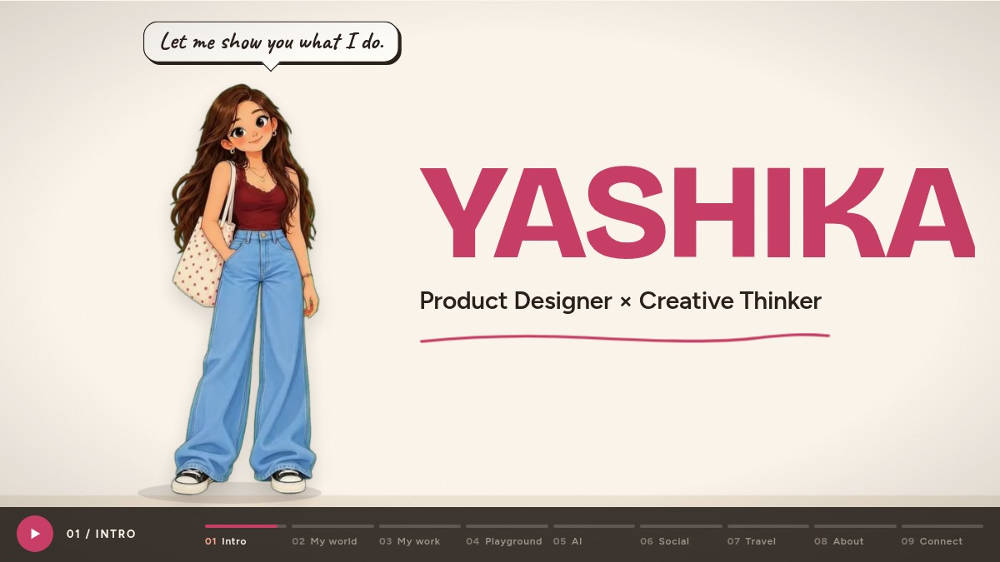

# Hi, I'm Yashika Varshney

**Product Designer. Creative Thinker. Professional overthinker.**

I design digital experiences, but I'm curious about a lot more than pixels. My work brings together enterprise UX, design systems, motion, and creative experimentation.

I like making sense of messy problems: understanding what people need, exploring the possibilities, and turning complex workflows into interfaces that feel clear and usable.

## What I do

- **Product design & enterprise UX** — dashboards, operational tools, and workflows that bring scattered information together.
- **Design systems** — shared patterns and a consistent visual language across products, roles, and modules.
- **Motion design** — micro-interactions, loaders, and playful details built with Lottie.
- **AI-assisted design** — rapid prototyping, visual exploration, and experiments with new ways of making things.

My process: **Understand → Explore → Design → Iterate → Ship.**

## Selected work

Some of the products I've worked on at EaseMyTrip:

### EMTDesk

A corporate travel console for travel managers and travellers. The design uses a shared grid and widget language, with different scopes for admins and employees and interchangeable modules for different client setups.

### QMS — From Query to Booking

An enterprise workflow that brings queries, profiles, calls, tickets, and bookings into one view. Rules-based routing and screens for five roles lead into a progressive package builder.

### EMT Analytics

As lead UI/UX designer across nine modules and six teams, I helped organize analytics around four questions: what is happening, why, which users are affected, and what should happen next?

My work also includes Enterprise CRM and EasyMail, bringing everyday operations into more connected, consistent interfaces.

## Beyond the brief

I'm a **Lottie Certified Creator** and **Lottie Squad Creator**. I enjoy making motion for product interfaces and have completed LottieFiles courses for Figma and Framer.

I share what I learn, experiment with AI in the design process, and sometimes make things simply to see what happens.

Travel is one of my favorite sources of inspiration. Places, street signs, colors, food, and small observations find their way into new ideas. Hanoi, Bangkok, Bali, and Almaty are part of that inspiration wall.

**Design. Travel. Learn. Explore. Experiment. Repeat.**

## Let's make something amazing

If you've got a problem worth solving, I'd love to hear about it.

- [Email me](mailto:yashikavarshney.yv@gmail.com)
- [LinkedIn](https://www.linkedin.com/in/yashika-varshney/)
- [Behance](https://www.behance.net/yashikavarshney2)
- [Dribbble](https://dribbble.com/yashie_uiux)
- [Instagram](https://www.instagram.com/uiux.yashie/)
